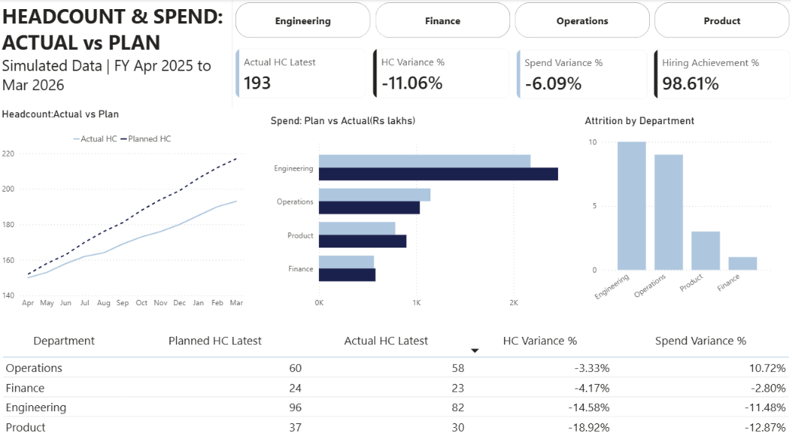

# Headcount & Spend: Actual vs Plan Dashboard | Power BI

An interactive Power BI dashboard for comparing planned and actual headcount, hiring, attrition, and operating spend across departments.

> **Note:** All data in this project is **simulated sample data** created for portfolio purposes. It does not come from any real company.

## 📊 Project Overview

This dashboard tracks four departments (Engineering, Finance, Operations, and Product) across a full fiscal year (Apr 2025 to Mar 2026) and shows where the business is off plan, with interactive filtering by department.

## 🛠️ Tools & Technologies

- Power BI
- DAX
- Power Query
- Excel
- PowerPoint
- Data Visualization

## 📌 Dashboard Features

- KPI cards for actual headcount, headcount variance %, spend variance %, and hiring achievement %
- Planned vs actual headcount trend by month
- Planned vs actual spend by department
- Attrition by department
- Department-level table with headcount and spend variance
- Interactive Department filter

## 📈 Dashboard Preview

## 🔍 Key Insights

- Actual headcount ended the year at **193 against a plan of 217**, which is **11.1% below plan**.
- Total spend was **6.1% under plan**, mainly because roles were unfilled rather than real savings.
- Overall hiring was close to plan (**71 of 72 planned hires, 98.6%**), so hiring alone does not explain the gap.
- **23 of the 24-person gap comes from attrition**, which the plan did not assume. Engineering lost 10 people and Operations lost 9.
- **Product (-18.9%) and Engineering (-14.6%)** have the largest headcount shortfalls.
- **Operations is 10.7% over its spend plan** even though its headcount is close to plan.

## 💡 Recommendations

- Tackle attrition first, starting with Engineering and Operations.
- Close the hiring gaps in Engineering and Product.
- Review what is driving Operations spend.
- Re-forecast the budget with an explicit attrition assumption.

## 📁 Files

- `Headcount_Spend_Dashboard.pbix`: Power BI report
- `Headcount_Spend_Sample_Data.xlsx`: simulated source data
- `Headcount_Spend_Dashboard_Summary.pptx`: 3-slide leadership summary
- `Dashboard.png`: dashboard screenshot

## 🎯 Project Objective

To turn planned vs actual workforce and spend data into an interactive dashboard that helps leadership see where hiring and budgets are off track, and why.
